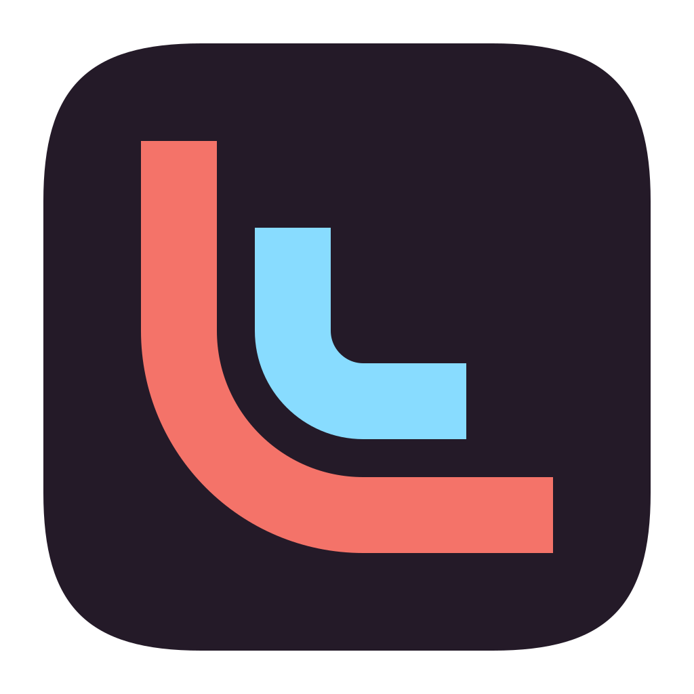
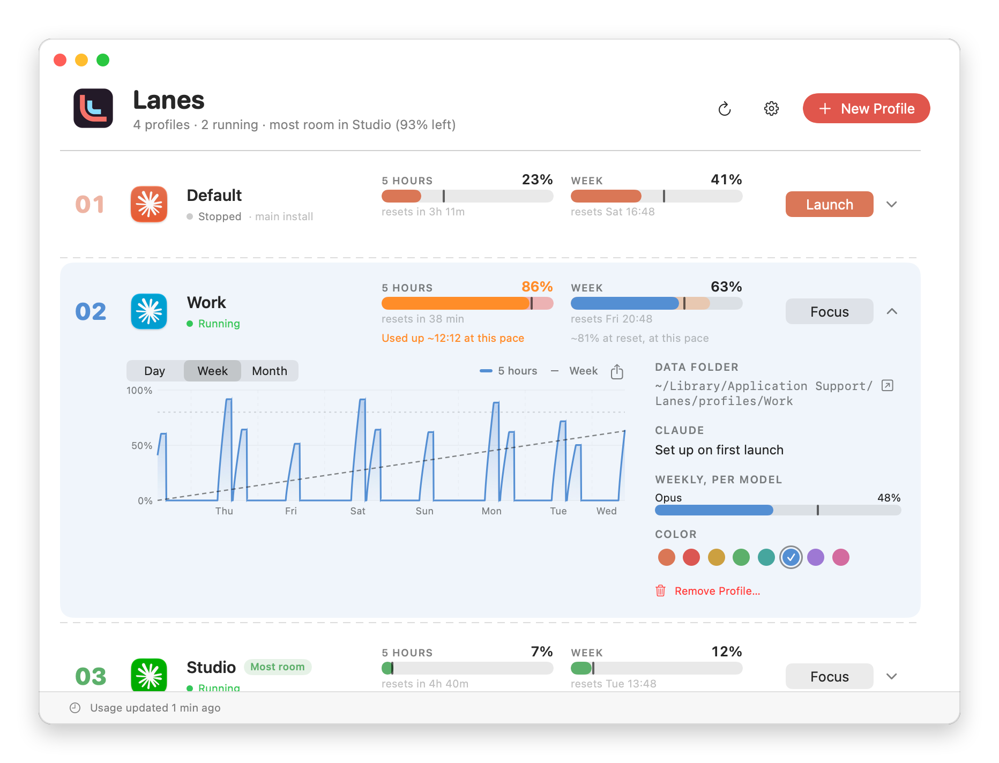
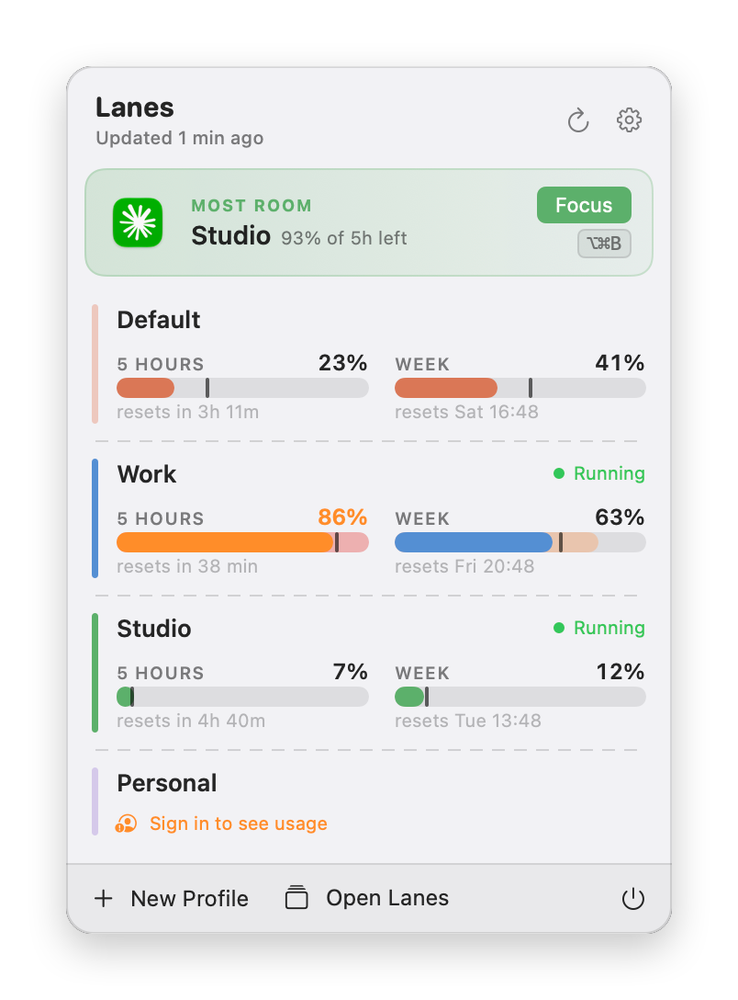
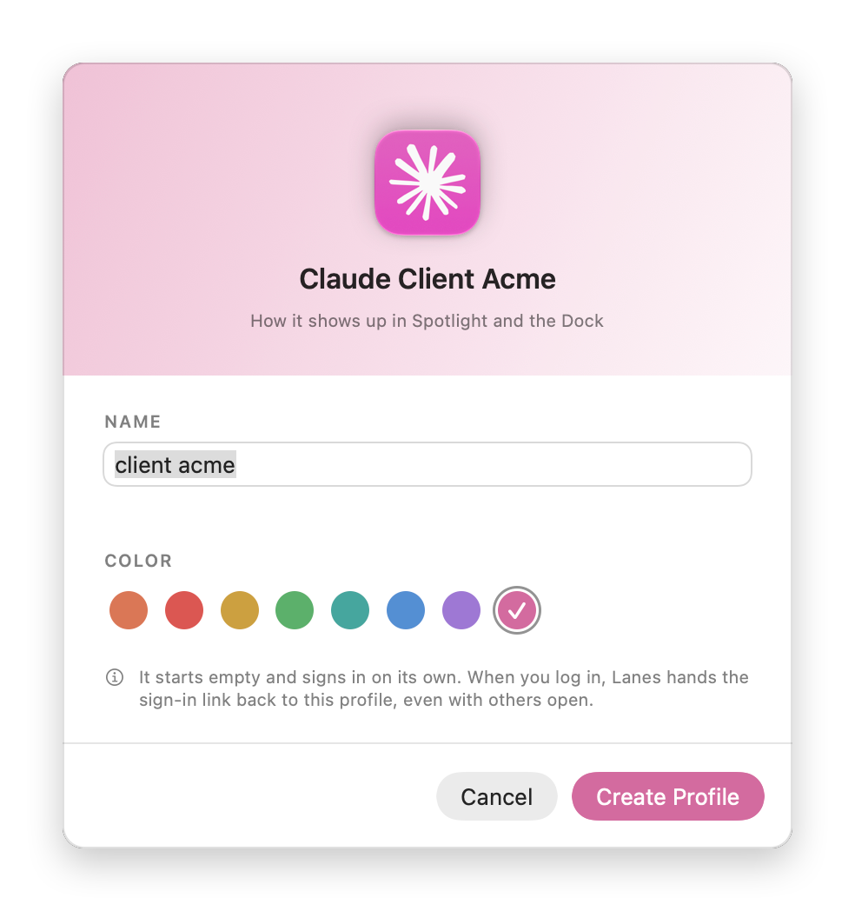
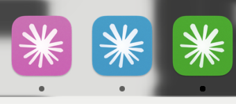
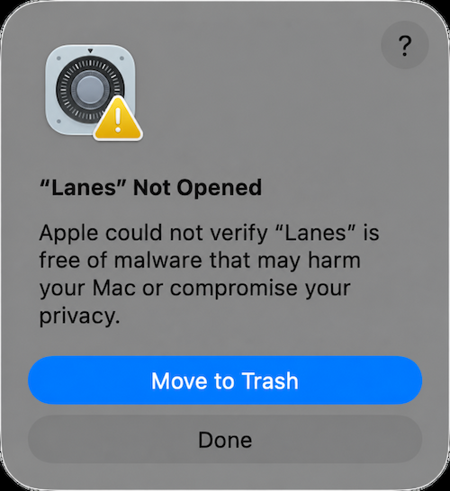
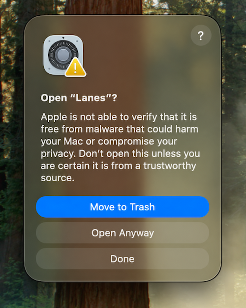

<p align="center">
  
</p>

<h1 align="center">Lanes</h1>

<p align="center">
  <b>Every Claude account in its own lane.</b><br>
  Run several Claude Desktop accounts side by side on your Mac,<br>
  and always know which one has room left.
</p>

<p align="center">
  <a href="#install"><b>Install</b></a> ·
  <a href="https://lanes.pego.tech">Website</a> ·
  <a href="docs/how-it-works.md">How it works</a> ·
  <a href="docs/cli.md">Command line</a> ·
  <a href="docs/faq.md">FAQ</a>
</p>

<p align="center">
  <picture>
    <source media="(prefers-color-scheme: dark)" srcset="docs/images/window-dark.png">
    
  </picture>
</p>

Claude Desktop signs in to one account at a time. If you have more than one
(work and personal, or one per client), you end up signing out and back in,
or living in a browser tab.

Lanes gives each account its own Claude. Each gets its own login, chats,
settings and connectors, and its own colored icon in the Dock and Spotlight,
and they all run at once. Each account also has its own usage limits, so
Lanes keeps an eye on all of them from the menu bar and points you to the
one with the most room.

<sub>Lanes is an independent project, not affiliated with or endorsed by Anthropic.</sub>

## A quick tour

### The track

Each profile is a numbered lane, painted in its color. At a glance you see
whether it's running, how much of its **5-hour** and **weekly** limits it has
used, and when each one resets. Click a lane to open its drawer, which holds
up to 30 days of usage history (by day, week or month, and exportable as
CSV), any per-model weekly limits such as Opus, where its data lives, its
color, and removal.

The small mark on every meter is the **pace marker**: how much of that
window has already passed. A bar that ends left of its marker is burning
slower than the clock, so 85% used with 20 minutes to go is nothing to
worry about.

Lanes also works out where each limit is **heading**. From the last hour of
readings (the last day, for the weekly limit) it draws a faint extension
to where the bar will be at the reset, and says so in orange when the
limit will run out first: *Used up ~15:40 at this pace*.

### The menu bar

<p>
  <picture>
    <source media="(prefers-color-scheme: dark)" srcset="docs/images/menu-dark.png">
    
  </picture>
</p>

Lanes lives in the menu bar, with no Dock icon. The icon is a tiny stack of
lanes, one gauge per profile filled to its 5-hour usage, next to the busiest
percentage. It turns orange at 75% and red at 90%.

<picture>
  <source media="(prefers-color-scheme: dark)" srcset="docs/images/menubar-dark.png">
  
</picture>

Open it and the profile with the **most room** comes first: one click (or
<kbd>⌥⌘B</kbd> from anywhere) opens it, or brings it forward if it's already
running. Below it, every lane with both meters. Click one to launch or focus
it; right-click to change its color, find its data or remove it.

**Alerts** arrive at 80% and 95% of the 5-hour and the weekly limit (both
levels are yours to change in Settings), and name the profile with the most
room. A **pace alert** warns you earlier, when a limit is on track to run
out well before it resets. Once a limit passes the first level, another one
lands the minute it resets, scheduled with macOS so it arrives even if Lanes
has quit.

<br clear="right">

### New lanes

<p>
  <picture>
    <source media="(prefers-color-scheme: dark)" srcset="docs/images/new-profile-dark.png">
    
  </picture>
</p>

Name it, pick one of eight colors, and you get a fresh, empty Claude called
"Claude &lt;Name&gt;", with a launcher in Spotlight and a matching tile in the
Dock.

Signing in works with other profiles open. Claude's login hands its token
back over a `claude://` link, and Lanes catches it. With one profile
running, the link goes straight there. With several, Lanes asks, with the
window you clicked "Log in" in already selected. It never lands on
whichever Claude happens to be running.



<br clear="right">

### Also included

- **A desktop widget** (macOS 14+) in three sizes, with live reset
  countdowns. Click a profile to open it. Add it with *Edit Widgets…* and
  search for "Lanes".
- **A command line**, `lanes`, for scripts and status lines:
  `lanes usage --json`, `lanes launch --best`, `lanes history --days 7`.
  See the [reference](docs/cli.md).
- **Isolated Claude Code, too.** The Code and Cowork tabs in each profile
  get their own Claude Code config, so accounts never leak into each other
  or into your terminal `claude`.
- **Hands-off updates.** Each profile installs Claude's updates on its
  own. A watchdog catches the relaunch after an update and puts the app
  back on the right account.

| Shortcut | |
|---|---|
| <kbd>⌥⌘P</kbd> | Open the menu bar panel |
| <kbd>⌥⌘B</kbd> | Open the profile with the most room |
| <kbd>⌘N</kbd> · <kbd>⌘R</kbd> · <kbd>⌘,</kbd> | New profile · refresh usage · settings (in the window) |

## Install

You need macOS 13 or later (Apple Silicon or Intel) and
[Claude Desktop](https://claude.ai/download) in Applications.

**The quick way:** paste this in Terminal.

```sh
curl -fsSL https://lanes.pego.tech/install | sh
```

It downloads the latest release, checks its signature, puts Lanes in
Applications and opens it. Files downloaded with `curl` aren't quarantined,
so there's no security prompt. [Read the script](site/install) first if you
like. Then **create a profile** with **New Profile**, open it and sign in.

**Or download it:**

1. **Download** `Lanes.dmg` from the [latest release](../../releases/latest),
   open it, and drag **Lanes** into Applications.
2. **Open it once, the long way.** Lanes isn't notarized by Apple, so the
   first launch stops with *"Lanes" Not Opened*. Click **Done**, then go to
   **System Settings → Privacy & Security**, scroll to **Security**, and
   click **Open Anyway**. Confirm once more with your password or Touch ID.
   This happens only once: updates install without it.

   <details>
   <summary>Show me</summary>
   <br>
   <table>
     <tr>
       <td align="center" valign="middle">
         
       </td>
       <td align="center" valign="middle">
         
       </td>
       <td align="center" valign="middle">
         
       </td>
     </tr>
     <tr>
       <td align="center"><sub><b>1.</b> First launch: click Done</sub></td>
       <td align="center"><sub><b>2.</b> Privacy &amp; Security: Open Anyway</sub></td>
       <td align="center"><sub><b>3.</b> Confirm</sub></td>
     </tr>
   </table>

   Or, from the Terminal:

   ```sh
   xattr -dr com.apple.quarantine /Applications/Lanes.app
   ```
   </details>
3. **Create a profile** with **New Profile**, then open it and sign in.

**Updates** install themselves: Lanes checks GitHub every few hours, installs
a new version and reopens (turn that off in **Settings → Updates** to be
asked first). From the Terminal, `lanes update`. On its first launch, the new
version refreshes your launchers and the watchdog. Profiles, logins and
colors stay as they are.

## Privacy

Lanes has no telemetry and no account of its own. Its only network traffic is
the usage check: the menu bar app asks claude.ai for each profile's usage,
using that profile's own session. The cookies are read from the profile's
cookie jar and never stored or sent anywhere else. Usage percentages and reset
times are kept locally for the widget, the CLI and the history chart. Your
main Claude install is never touched. The whole thing is about 4,000 lines of
Swift and shell you can read in an afternoon.

## Under the hood

Claude Desktop is an Electron app, and Electron honors Chromium's
`--user-data-dir` flag: point it at another folder and you get a fully
separate Claude. Lanes is that one flag, plus everything it takes to make it
feel native: copy-on-write clones that cost no disk, tinted icons that keep
the code signature intact, a watchdog for updates, and link routing for
sign-in. The full story is in **[How it works](docs/how-it-works.md)**.

## More

- [How it works](docs/how-it-works.md): clones, colors, updates, links, usage
- [Command line](docs/cli.md): every `lanes` command, plus the usage file formats
- [FAQ](docs/faq.md): your existing Claude, disk space, updates, the terms of service
- [Development](docs/development.md): building from source, tests, screenshots

## Credits

Lanes builds on work by [odahcam](https://github.com/odahcam), who wrote the
profile isolation, clones, launchers and watchdog at its core. The underlying
recipe is community knowledge, and
[claude-multiprofile](https://github.com/jmdarre-v/claude-multiprofile)
deserves credit as prior art that proved it solid.

[MIT License](LICENSE)
